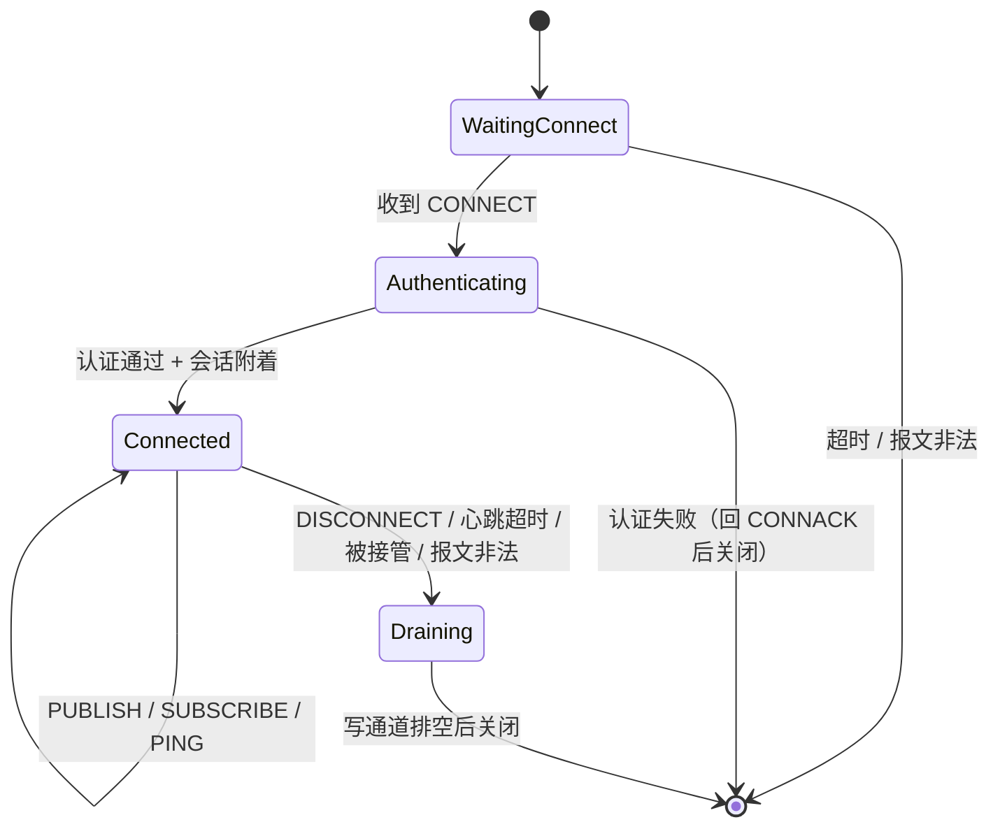

# MQTT Server 集成设计方案

> 目标包：`YLFramework.AspNetCore.Middleware`
> 触发方式：`ListenOptions.UseMqttBroker()` + `services.AddMqttBroker(...)`
> 文档状态：设计评审中，尚未落地代码
> 路线说明：§3～§6 描述**自研实现**；§2 给出两条路线对比，**附录 B** 是「基于 MQTTnet 的薄封装」路线，两条路线的对外 API 一致，可互换。

## 1. 目标与非目标

### 1.1 目标

1. 在 `Framework.AspNetCore.Middleware` 内提供一个**内嵌 MQTT Broker**，与 Echo / Telnet / Modbus 一样通过 `ListenOptions` 一行接入 Kestrel。
2. 支持 MQTT **3.1 / 3.1.1 / 5.0**，5.0 按「完整属性支持」实现（含主题别名、流控、增强认证、订阅标识符、会话过期等）。
3. 零第三方 broker 依赖，不引入反射，保持 AOT / trimming 友好。
4. 应用层可通过 `IMqttBroker` 主动下发消息、观测上下线与消息事件。
5. 与既有中间件可叠加：TLS 由 `UseHttps()` 提供，流量统计由 `UseFlowAnalyze()` 提供，MQTT 层不重复实现。

### 1.2 非目标（本期明确不做）

| 项目 | 原因 / 替代方案 |
|------|----------------|
| 集群桥接、多节点共享订阅 | 需要分布式状态，超出单进程 broker 范围 |
| 消息与会话持久化 | 内存态实现；如需持久化，后续抽 `IMqttMessageStore` |
| 主题级 ACL 授权 | 首版只做连接认证；ACL 预留 `IMqttAuthorizer` 扩展点 |
| `$SYS` 系统主题 | 指标通过 `System.Diagnostics.Metrics` + 事件暴露，不占用主题空间 |
| WebSocket 传输 | 客户端用 `ws://` 属另一套握手，后续单独评估 |
| MQTT over QUIC | 无成熟 BCL 支持 |

## 2. 选型：自研 vs 引入 MQTTnet

### 2.1 事实澄清：MQTTnet 支持 Server，且官方就有 Kestrel 集成

| NuGet 包 | 作用 | 现状（2026-10 核查） |
|----------|------|---------------------|
| `MQTTnet` | 协议核心，客户端 + 服务端共用 | 5.2.0.1603，2026-07 发布，MIT |
| `MQTTnet.Server` | Broker 实现（会话、保留、订阅校验、拦截器） | 同版本号 |
| `MQTTnet.AspNetCore` | `ListenOptions.UseMqtt()`、`AddHostedMqttServer()`、`AddMqttConnectionHandler()` | 5.2.0.1603，目标框架 net8.0 / net10.0 |

也就是说，MQTTnet 走的路子和本包现有中间件**完全一致**：注册一个 `ConnectionHandler` 挂到 Kestrel 端点，同样可以与 `UseHttps()` / `UseFlowAnalyze()` 叠加。

**因此「无法与 Kestrel 管道融合」不成立，不能作为自研理由。** 真实的取舍是下面这些：

| 维度 | 自研 | 引入 MQTTnet.AspNetCore |
|------|------|------------------------|
| 依赖面 | 0 个新 NuGet | 3 个直接包 + 传递依赖，需写入 `Directory.Packages.props` |
| 协议完整度（3.1/3.1.1/5.0、QoS2、别名、流控） | 自己实现并逐条对齐，需自证 | 已实现，附带约 600 个上游单测 |
| AOT / trimming | 全手写，天然友好 | **需实测**（v5 重写后是否存在反射未验证） |
| 可观测与扩展点 | 自己定义，需从零写 | 官方事件齐全（连接、订阅、发布拦截、消息入队），但 API 面大 |
| 实现与维护成本 | 约 3.5k 行 + 测试，协议缺陷自担 | 薄封装 + 选项映射，缺陷可跟上游（发版节奏约半年一次） |
| 与包定位的一致性 | 与 Modbus/Echo 同构，包内协议实现全部自持 | 引入第三方协议栈，包变成「聚合层」 |
| 许可证 | 自有 | MIT，商用无附加条款 |

### 2.2 推荐路线

**分两步走（推荐）**：

1. **第一步落地**：基于 `MQTTnet.AspNetCore` 做薄封装，把 `UseMqttBroker()` / `AddMqttBroker()` 定为本包的稳定入口，内部转调 MQTTnet。1～2 周即可拿到可用 Broker + 5.0 属性完整支持，且 API 面由我们收窄（不用把 MQTTnet 的整套事件模型暴露给使用方）。
2. **按需替换**：若后续对依赖面、AOT 或包体积有硬约束，再用自有实现换掉 `IMqttBroker` 背后的实现，**调用方代码不变**——这也是本方案坚持先定义 `IMqttBroker` 抽象的原因。

**何时直接选自研**：包对外承诺「零第三方协议栈」，或需要 MQTTnet 不提供的定制语义（例如把会话状态挂到本仓库的存储抽象上）。

> 两条路线的对公 API（`UseMqttBroker` / `AddMqttBroker` / `IMqttBroker` / `MqttBrokerOptions`）完全一致，附录 B 给出 MQTTnet 路线的映射细节。

## 3. 总体架构

```
┌──────────────────────────────────────────────────────────────┐
│ MQTT 客户端（3.1 / 3.1.1 / 5.0）                              │
└───────────────────────────┬──────────────────────────────────┘
                            │ TCP（TLS 由 UseHttps 提供）
┌───────────────────────────▼──────────────────────────────────┐
│ Kestrel Listener：listen.UseMqttBroker()                      │
│ ┌──────────────────────────────────────────────────────────┐ │
│ │ 连接层  MqttConnectionHandler → MqttClientConnection      │ │
│ │  · 读循环（增量解析，批内出包）                            │ │
│ │  · 写循环（单消费者 Channel<MqttPacket>，独占 PipeWriter） │ │
│ │  · 心跳 / 连接超时 / QoS 收发状态机 / 主题别名表           │ │
│ └───────────────────────────┬──────────────────────────────┘ │
│ ┌───────────────────────────▼──────────────────────────────┐ │
│ │ 路由层  MqttBroker（单例）                                 │ │
│ │  · 会话注册表 clientId → MqttSession                      │ │
│ │  · 订阅路由 / 共享订阅轮询 / 保留消息                      │ │
│ │  · 事件：ClientConnected / ClientDisconnected / Message   │ │
│ └───────────────────────────┬──────────────────────────────┘ │
└─────────────────────────────┼────────────────────────────────┘
                              │
┌─────────────────────────────▼────────────────────────────────┐
│ 应用层：IMqttBroker.PublishAsync / 事件订阅 / IMqttAuthenticator│
└──────────────────────────────────────────────────────────────┘
```

任务模型（每个连接最多 2 个常驻任务 + 1 个定时器）：

| 任务 | 归属 | 职责 |
|------|------|------|
| 读循环 | 连接 | `PipeReader.ReadAsync` → 解析 → 分派；负责 keep-alive 数据面超时判定 |
| 写循环 | 连接 | 消费 `Channel<MqttPacket>` → `WriteTo` → `FlushAsync`；唯一写 `PipeWriter` 的地方 |
| 心跳定时器 | 连接 | `Timer`，`1.5 × keepAlive` 内无入站报文则 `Abort` 并触发遗嘱 |
| 会话清理 | Broker（单例） | 周期性清扫 `SessionExpiryInterval` 到期的离线会话 |

## 4. 代码结构与文件清单

```
src/Framework.AspNetCore.Middleware/Mqtt/
├─ Protocol/
│  ├─ MqttProtocolVersion.cs        协议版本枚举（3/4/5）
│  ├─ MqttPacketType.cs             14 类控制报文
│  ├─ MqttQualityOfServiceLevel.cs  QoS 0/1/2
│  ├─ MqttConnectReturnCode.cs      3.x 返回码（编码时映射 5.0 原因码）
│  ├─ MqttDisconnectReasonCode.cs   5.0 原因码
│  ├─ MqttReadStatus.cs             Incomplete / Success / Malformed
│  ├─ MqttProtocolException.cs      协议层异常
│  ├─ MqttBufferWriter.cs           写入原语（byte/u16/u32/string/binary/varint）
│  ├─ MqttPacket.cs                 报文基类：自动写固定头 + 剩余长度
│  └─ MqttPacketCodec.cs            增量解析：固定头、varint、属性段、按类型分发
├─ Packets/
│  ├─ MqttConnectPacket.cs          CONNECT（含 will / 5.0 属性）
│  ├─ MqttConnAckPacket.cs          CONNACK
│  ├─ MqttPublishPacket.cs          PUBLISH（含主题别名、属性透传）
│  ├─ MqttPubAckPacket.cs           PUBACK / PUBREC / PUBREL / PUBCOMP
│  ├─ MqttSubscribePacket.cs        SUBSCRIBE
│  ├─ MqttSubAckPacket.cs           SUBACK
│  ├─ MqttUnsubscribePacket.cs      UNSUBSCRIBE
│  ├─ MqttUnsubAckPacket.cs         UNSUBACK
│  ├─ MqttControlPackets.cs         PINGREQ / PINGRESP / DISCONNECT / AUTH
│  └─ MqttProperties.cs             5.0 属性集合（读写 + 逐属性类型表）
├─ MqttTopicFilter.cs               过滤器校验、+/# 匹配、$share 解析
├─ MqttSubscription.cs              订阅项（filter、QoS、NoLocal、RAP、RetainHandling、订阅标识符）
├─ MqttPublication.cs               消息模型（主题、载荷、QoS、retain、属性、过期时刻）
├─ MqttSession.cs                   会话：订阅表、离线队列、inflight、过期时刻
├─ MqttBroker.cs                    会话注册表、路由、保留消息、事件、清扫
├─ MqttClientConnection.cs          单连接状态机（internal）
├─ MqttConnectionHandler.cs         ConnectionHandler 桥接
├─ MqttBrokerOptions.cs             配置项
├─ IMqttBroker.cs                   应用层接口 + 事件参数 + MqttClientInfo
├─ IMqttAuthenticator.cs            基础认证扩展点（+ 增强认证）
├─ ListenOptionsExtensions.cs       UseMqttBroker()
└─ ServiceCollectionExtensions.cs   AddMqttBroker() / AddMqttBroker<T>()
```

命名空间统一 `Middleware.Mqtt`，与同目录 `Middleware.Modbus` / `Middleware.Echo` 保持一致。

## 5. 协议支持矩阵

### 5.1 报文

| 报文 | 服务端接收 | 服务端发送 | 说明 |
|------|:---:|:---:|------|
| CONNECT | ✓ | — | 协议名/级别校验、空 clientId、遗嘱、认证 |
| CONNACK | — | ✓ | 5.0 回 Assigned Client Identifier / Server Keep Alive / Topic Alias Maximum 等 |
| PUBLISH | ✓ | ✓ | QoS 0/1/2，主题别名，属性透传 |
| PUBACK / PUBREC / PUBREL / PUBCOMP | ✓ | ✓ | 双向 QoS 状态机 |
| SUBSCRIBE / SUBACK | ✓ | ✓ | 多订阅项、5.0 订阅选项、订阅标识符 |
| UNSUBSCRIBE / UNSUBACK | ✓ | ✓ | 逐过滤器原因码 |
| PINGREQ / PINGRESP | ✓ | ✓ | — |
| DISCONNECT | ✓ | ✓ | 5.0 原因码，0x04 表示仍发遗嘱 |
| AUTH | ✓ | ✓ | 仅增强认证流启用时 |

### 5.2 特性

| 特性 | 支持 | 备注 |
|------|:---:|------|
| QoS 0 / 1 / 2 | ✓ | QoS2 四段握手 + 入站 packetId 去重 |
| 会话（CleanSession / CleanStart + Session Expiry） | ✓ | 订阅表 + 离线队列 + inflight 跨连接保留 |
| 保留消息 | ✓ | 含清空（空载荷 retain=1）、`Message Expiry` 过期、`Retain Available=0` 时拒绝 |
| 遗嘱消息 | ✓ | 含 `Will Delay Interval` 延迟发布 |
| 共享订阅 `$share/{group}/{filter}` | ✓ | 组内轮询；组内成员掉线自动剔除 |
| 通配符 `+` / `#` | ✓ | `$` 开头主题不被首级通配符匹配 |
| 会话接管（同 clientId） | ✓ | 旧连接以 0x8E 断开并触发遗嘱 |
| 主题别名 | ✓ | 入站映射 + 每连接独立出站映射 |
| 流控（Receive Maximum） | ✓ | 双向配额，见 6.5 |
| 增强认证（AUTH） | ✓ | 通过 `IMqttEnhancedAuthenticator` 挂载 |
| 订阅标识符 | ✓ | 下发 PUBLISH 时携带命中订阅的标识符（合并去重） |
| `$SYS` / 桥接 / 持久化 / ACL | ✗ | 见 1.2 |

### 5.3 MQTT 5.0 属性逐条策略（完整支持）

| 属性 | 方向 | 实现策略 |
|------|------|---------|
| 0x01 Payload Format Indicator | 双向 | 透传；不强制校验 UTF-8（非法时按 0x99 断开，可配置为宽松模式） |
| 0x02 Message Expiry Interval | 双向 | 保留消息存绝对到期时刻；离线队列入队存到期时刻，转发时减去已消耗时间，过期丢弃 |
| 0x03 Content Type | 双向 | 透传 |
| 0x08 Response Topic | 双向 | 透传 |
| 0x09 Correlation Data | 双向 | 透传 |
| 0x0B Subscription Identifier | 双（SUBSCRIBE 入 / PUBLISH 出） | 订阅时记录（允许一次订阅多项不同标识符）；下发时收集命中订阅的标识符，多个则重复出现 |
| 0x11 Session Expiry Interval | 双向 | 连接时记录；DISCONNECT 可覆盖；到期后会话被清扫线程移除 |
| 0x12 Assigned Client Identifier | 出 | 空 clientId 且 CleanStart=1 时生成 `auto-{16hex}` 并回发 |
| 0x13 Server Keep Alive | 出 | 配置 `MaxKeepAlive` 时对超限客户端回发实际值并以其为准 |
| 0x15 Authentication Method | 双向 | 增强认证协商，见 6.6 |
| 0x16 Authentication Data | 双向 | 同上 |
| 0x17 Request Problem Information | 入 | 0 时不回 Reason String / User Property，仅回原因码 |
| 0x18 Will Delay Interval | 入 | 延迟发布遗嘱；延迟内同 clientId 重连则取消 |
| 0x19 Request Response Information | 入 | 1 且配置了 `ResponseInformation` 时在 CONNACK 回 0x1A |
| 0x1A Response Information | 出 | 来自 `MqttBrokerOptions.ResponseInformation` |
| 0x1C Server Reference | 出 | 配置了 `ServerReference` 时在 CONNACK/DISCONNECT 回发（重定向提示） |
| 0x1F Reason String | 出 | 错误场景回发（受 0x17 限制） |
| 0x21 Receive Maximum | 双向 | 入：限制客户端在途 QoS>0 报文；出：遵守客户端配额，见 6.5 |
| 0x22 Topic Alias Maximum | 出 | CONNACK 声明服务端接受的最大别名数（`MqttBrokerOptions.TopicAliasMaximum`，默认 0 表示不接受） |
| 0x23 Topic Alias | 双向 | 入站：`topic` 为空时按别名还原，别名 > 声明值则断开（0x94）；出站：按客户端声明的上限自行分配并在后续报文复用 |
| 0x24 Maximum QoS | 出 | `MqttBrokerOptions.MaximumQosLevel`；超限的 SUBSCRIBE 返回 0x9B |
| 0x25 Retain Available | 出 | 关闭保留消息时回 0；客户端仍带 retain=1 则断开（0x9A） |
| 0x26 User Property | 双向 | CONNECT 上的交给认证器；PUBLISH 上透传并随事件暴露 |
| 0x27 Maximum Packet Size | 双向 | 入站超限按 0x95 断开；出站超限丢弃该消息并记日志（QoS>0 时回对应失败原因码） |
| 0x28 Wildcard Subscription Available | 出 | 可通过配置关闭，关闭后带通配符的订阅返回 0xA2 |
| 0x29 Subscription Identifier Available | 出 | 同上，关闭后 SUBSCRIBE 带标识符返回 0xA1 |
| 0x2A Shared Subscription Available | 出 | 同上，关闭后共享订阅返回 0x9E |
| 0x0C/0x0D（旧草案属性） | — | 不支持，遇到即 0x82 |

## 6. 关键机制

### 6.1 连接状态机



要点：

- `WaitingConnect` 期间只接受 CONNECT；收到其他报文直接断开（0x82）。
- 认证在 CONNECT 上完成，失败仍先回 CONNACK 再关闭（3.x 语义要求）。
- `Draining` 阶段不再读，只把剩余出站报文 flush 完，保证 DISCONNECT 原因码能送出去。

### 6.2 并发模型与锁序

- **写路径唯一**：所有出站报文（响应、转发、心跳）都投递到连接的 `Channel<MqttPacket>`，只有写循环碰 `PipeWriter`，从根上排除并发写坏管道。
- **锁序单向**：`MqttSession.SyncRoot → 连接 inflight 表`，任何路径不得反向持锁。断开时先在 inflight 锁内取快照、释放，再去 session 锁回灌队列。
- **投递无阻塞**：`Broker.Route` 只在会话锁内做「入队 / 投通道」，不做网络 IO；慢客户端由队列上限兜底。
- **背压策略**（`MqttBrokerOptions`）：
  - 每会话离线队列上限 `MaxPendingMessages`（默认 1000）：满了丢弃**最旧**的 QoS0，QoS1/2 丢弃最旧并记 `dropped` 计数；
  - 每连接在途 QoS>0 上限 = `min(ReceiveMaximum, MaxInflightMessages)`，超出发送侧暂停，剩余留在会话队列；
  - 写通道为无界但受上面两道上限约束，正常不会失控。

### 6.3 QoS 状态机

**入站（客户端 → 服务端）**

| QoS | 处理 |
|-----|------|
| 0 | 直接路由 |
| 1 | 路由后回 PUBACK |
| 2 | packetId 不在去重集合 → 路由并加入集合；回 PUBREC；收到 PUBREL 后移出集合并回 PUBCOMP（重复 PUBLISH 只重发 PUBREC） |

**出站（服务端 → 客户端）**

| QoS | 处理 |
|-----|------|
| 0 | 直接写 |
| 1 | 分配 packetId → 记 inflight → 写；收到 PUBACK 移除 |
| 2 | 分配 packetId → 记 inflight(WaitPubRec) → 写；收到 PUBREC 转 WaitPubComp 并回 PUBREL；收到 PUBCOMP 移除 |

**重连补发**：会话 `cleanSession=false` 时，断开前未确认的出站消息在会话锁内回灌队列头部，重连后按原序重发并置 `DUP=1`。
QoS2 的补发按「重新发送 PUBLISH（新 packetId）」处理，不做跨连接的 PUBREL 续接——这是与严格 exactly-once 的已知偏差，会在 README 明确标注。

### 6.4 会话生命周期

```
新建 → 附着(Attach) → 在线 → 分离(Detach) → 离线（保留订阅 + 队列）
                                              ├─ 重连：恢复订阅、回灌队列、sessionPresent=1
                                              ├─ CleanStart=1：清空旧状态
                                              └─ 过期：清扫线程回收
```

- 3.x：`CleanSession=0` 视为永不过期；`CleanSession=1` 断开即删会话。
- 5.0：以 `Session Expiry Interval` 为准；DISCONNECT 可携带新值覆盖；0 表示断开即删。
- 清扫：Broker 内单个 `Timer`（默认 30s）扫描 `ExpiresAt`，避免每会话一个定时器。

### 6.5 流控（Receive Maximum）与报文大小

- **入站配额**：CONNACK 声明服务端 `ReceiveMaximum`（默认 100）。客户端在途 QoS>0 报文数超配额视为协议错误（0x93）。
- **出站配额**：遵守客户端 CONNECT 中的 `Receive Maximum`，在途未确认数达上限即停止从会话队列取消息，待 ACK 归还配额后继续。
- **最大报文**：`Maximum Packet Size` 双向生效；入站超 `MaxPacketSize` 直接 0x95 断开，出站超客户端上限则丢弃并计入 `dropped`。

### 6.6 认证与增强认证

```csharp
public interface IMqttAuthenticator
{
    ValueTask<MqttConnectReturnCode> AuthenticateAsync(MqttConnectInfo connect, CancellationToken ct);
}

public interface IMqttEnhancedAuthenticator : IMqttAuthenticator
{
    // 返回 Continued 时服务端回 AUTH(0x18) 继续握手
    ValueTask<MqttAuthResult> ContinueAsync(MqttAuthContext context, ReadOnlyMemory<byte> data, CancellationToken ct);
}
```

- 基础认证：一次判定，失败映射为 3.x 返回码 / 5.0 原因码（0x04→0x86，0x05→0x87）。
- 增强认证：仅 5.0 且客户端声明 `Authentication Method` 时启用；服务端以 AUTH(0x18) 续接，最多 `MaxAuthRounds`（默认 5）轮。
- 密码以 `ReadOnlyMemory<byte>` 传递（不做 UTF-8 假设），并额外提供 `PasswordText` 便捷属性。

### 6.7 保留消息

- `retain=1` 且载荷非空 → 覆盖写入 `retained[topic]`，同时记录 `Message Expiry` 绝对到期时刻。
- `retain=1` 且载荷为空 → 删除该主题保留消息，**不转发**给订阅者（3.1.1 语义），但向已有订阅者转发空载荷（5.0 语义保持与 3.x 一致，仅清理）。
- 订阅时按 `RetainHandling` 决定是否补发：0 总是、1 仅新订阅、2 从不下发；补发时 `retain=1`（不受 RAP 影响）。
- 共享订阅不补发保留消息。

### 6.8 遗嘱与延迟

- 记录于连接上，仅在其「异常断开」时发布：网络中断、心跳超时、报文非法、会话被接管、DISCONNECT(0x04)。
- 正常 DISCONNECT(0x00) 不发布。
- `Will Delay Interval`：延迟期间若同 clientId 重连成功则取消发布；延迟到点才入路由。
- 遗嘱发布走与普通发布相同的路由与保留逻辑（`will.retain` 生效）。

### 6.9 主题别名

- **入站**：`Topic Alias Maximum` 为 0 时收到别名即断开（0x94）；否则维护 `Dictionary<ushort, string>`，`topic` 为空时用别名还原；未注册别名即断开。
- **出站**：客户端声明上限 N>0 时，服务端为高频长主题分配别名，首次带 topic+alias，后续只带 alias。映射表随连接销毁。
- 别名的 `topic` 与 `alias` 同时出现时以 topic 为准并刷新映射。

### 6.10 错误处理与原因码

| 场景 | 处理 |
|------|------|
| 报文格式非法 | 断前尝试发 DISCONNECT(0x81)；已无法解析则直接 Abort |
| 协议状态非法（重复 CONNECT 等） | DISCONNECT(0x82) |
| 报文超限 | DISCONNECT(0x95) |
| 主题名非法 | DISCONNECT(0x90)；PUBLISH 场景也可只丢弃并记日志（可配置） |
| 订阅过滤器非法 | SUBACK 对应项返回 0x8F，不断开 |
| 服务端内部异常 | 记 Error 日志，回 QoS 对应失败原因码，连接保持 |

3.x 无原因码：一律「断开连接」+ 日志，CONNACK 场景使用对应返回码。

### 6.11 可观测性

- 日志：连接建立/断开（含 clientId、版本、远端地址、原因）、订阅变更、保留消息覆盖、队列丢弃、认证失败。全部使用结构化占位符。
- 事件：`ClientConnected` / `ClientDisconnected` / `MessageReceived`（仅入站，避免回环）、`MessageDropped`。
- 指标（`System.Diagnostics.Metrics`，Meter 名 `YLFramework.Mqtt`）：`connections.active`、`messages.received`、`messages.sent`、`messages.dropped`、`sessions.active`、`inflight.count`。

## 7. 对外 API

### 7.1 注册与接入

```csharp
builder.Services.AddMqttBroker(o =>
{
    o.MaxPacketSize = 2 * 1024 * 1024;
    o.ReceiveMaximum = 100;
    o.EnableRetainedMessages = true;
    o.TopicAliasMaximum = 16;
    o.MaximumQosLevel = MqttQualityOfServiceLevel.ExactlyOnce;
    o.MaxPendingMessages = 1000;
});

builder.WebHost.ConfigureKestrel(options =>
{
    options.ListenAnyIP(1883, l => l.UseMqttBroker());
    options.ListenAnyIP(8883, l =>
    {
        l.UseHttps();
        l.UseFlowAnalyze(analyzer);
        l.UseMqttBroker();
    });
});
```

### 7.2 应用层接口

```csharp
public interface IMqttBroker
{
    IReadOnlyList<MqttClientInfo> GetClients();
    ValueTask PublishAsync(string topic, ReadOnlyMemory<byte> payload,
        MqttQualityOfServiceLevel qos = MqttQualityOfServiceLevel.AtMostOnce,
        bool retain = false, CancellationToken ct = default);
    ValueTask<bool> DisconnectClientAsync(string clientId, bool sendWillMessage = false, CancellationToken ct = default);

    event EventHandler<MqttClientConnectedEventArgs>? ClientConnected;
    event EventHandler<MqttClientDisconnectedEventArgs>? ClientDisconnected;
    event EventHandler<MqttMessageEventArgs>? MessageReceived;
}
```

### 7.3 选项（`MqttBrokerOptions`）

| 选项 | 默认 | 说明 |
|------|------|------|
| `MaxPacketSize` | 1 MiB | 入站报文上限，超限 0x95 |
| `ConnectTimeout` | 10s | 建立连接超时 |
| `MaxKeepAlive` | 0（不限） | >0 时对超限客户端下发 Server Keep Alive |
| `ReceiveMaximum` | 100 | 服务端接受的在途 QoS>0 报文数 |
| `MaxInflightMessages` | 64 | 出站在途上限（再与客户端配额取小） |
| `MaxPendingMessages` | 1000 | 会话离线队列上限 |
| `MaximumQosLevel` | ExactlyOnce | 声明给客户端的最大 QoS |
| `EnableRetainedMessages` | true | 关闭后 CONNACK 声明 Retain Available=0 |
| `EnableWildcardSubscriptions` | true | 关闭后带通配符订阅返回 0xA2 |
| `EnableSharedSubscriptions` | true | 关闭后共享订阅返回 0x9E |
| `EnableSubscriptionIdentifiers` | true | 关闭后带标识符订阅返回 0xA1 |
| `TopicAliasMaximum` | 0 | 服务端接受的最大别名数 |
| `AllowAnonymous` | true | 无任何认证器时的兜底策略 |
| `SessionSweepInterval` | 30s | 过期会话清扫周期 |
| `ResponseInformation` | null | 回 0x1A 的模板 |
| `ServerReference` | null | 回 0x1C 的重定向提示 |
| `MaxAuthRounds` | 5 | 增强认证最大轮次 |

## 8. 测试计划

### 8.1 单元测试

| 用例组 | 内容 |
|--------|------|
| 变长整数 | 0 / 127 / 128 / 16383 / 2097151 / 268435455 边界往返 |
| 报文往返 | 每种报文 × {3.1.1, 5.0}，编码→解码→字段比对 |
| 属性解析 | 每个 5.0 属性单独用例 + 多属性组合 + 未知属性（0x82） |
| 主题匹配 | 表驱动：`+` / `#` / 父子层 / 空层 / `$SYS` / 共享订阅 |
| 原因码映射 | 3.x 返回码 ↔ 5.0 原因码 |

### 8.2 端到端测试（真起 Kestrel）

测试工程 `test/Framework.AspNetCore.Middleware.Tests`，用 `WebApplication` + `Listen(IPAddress.Loopback, 0)` 取实际端口，客户端复用包内编解码（`MqttPacket.ToArray()`）。

| 场景 | 断言 |
|------|------|
| 连接 | CONNACK=0，空 clientId 得到 Assigned Client Identifier |
| 订阅发布 | QoS0 收到、topic 一致 |
| QoS1 | 收到 PUBACK；断开重连后未确认消息带 DUP 重发 |
| QoS2 | PUBREC→PUBREL→PUBCOMP 全流程，重复 PUBLISH 只投递一次 |
| 保留 | 新订阅者立即收到，`retain=1`；空载荷清除 |
| 遗嘱 | 强杀连接后订阅者收到遗嘱；正常 DISCONNECT 不收到 |
| 会话接管 | 同 clientId 二次连接，旧连接被断开，sessionPresent=1 |
| 主题别名 | 首报文带 topic+alias，次报文只带 alias 仍能路由 |
| 流控 | `Receive Maximum=1` 时第二条约 QoS1 延迟发送 |
| 会话过期 | Session Expiry=1 断开后 >1s 会话被清扫，重连 sessionPresent=0 |

### 8.3 互操作（手工清单，写入 README）

`mosquitto_pub/sub`、MQTTX、Eclipse Paho（Java/Python）各跑一遍连接 + 订阅 + 发布 + 保留 + 遗嘱。

## 9. 风险与缓解

| 风险 | 影响 | 缓解 |
|------|------|------|
| QoS2 重连补发不满足严格 exactly-once | 极端场景重复投递 | 文档明确标注；如需严格语义，后续在 inflight 中持久化 `PUBREL` 阶段状态 |
| 载荷全量复制进内存 | 大报文内存峰值 | 入站按 `MaxPacketSize` 截断；后续可引入 `ReadOnlySequence` 零拷贝投递 |
| 慢客户端拖垮服务端 | 内存增长 | 离线队列上限 + 在途配额 + 出站报文大小上限 |
| 5.0 属性组合爆炸 | 漏测 | 属性表驱动 + 逐属性用例 + 组合用例 |
| 线性订阅扫描 | 大连接数下 CPU 偏高 | 首版接受；预留 `MqttSubscriptionTable` 抽象，可替换为主题树 |
| 无 ACL | 主题越权 | 预留 `IMqttAuthorizer`；首版在 README 提示生产环境需在认证器内做校验或使用网络隔离 |

## 10. 实施计划（按 PR 拆分）

| 阶段 | 内容 | 可独立合并 |
|------|------|:---:|
| P0 | 协议基础：枚举、`MqttBufferWriter`、`MqttPacket`、`MqttPacketCodec`（3.1.1 全报文） | ✓ |
| P1 | 连接层：`MqttConnectionHandler` + `MqttClientConnection`（CONNECT/CONNACK/PING/DISCONNECT）、DI 与 `UseMqttBroker()` | ✓ |
| P2 | 路由层：会话、订阅、QoS0/1 转发、保留消息 | ✓ |
| P3 | QoS2 + 会话恢复 + 遗嘱 + 会话接管 | ✓ |
| P4 | MQTT 5.0 完整属性：主题别名、流控、订阅标识符、会话过期、原因码 | ✓ |
| P5 | 增强认证、Metrics、事件、过期清扫 | ✓ |
| P6 | 测试工程、互操作验证、README 表格与示例、包版本号提升 | ✓ |

## 11. 附录：核心循环伪代码

```csharp
// 读循环：一次 ReadAsync 内解析完所有完整报文，再统一 AdvanceTo
while (token.IsCancellationRequested == false)
{
    var result = await input.ReadAsync(token);
    var buffer = result.Buffer;
    var reader = new SequenceReader<byte>(buffer);
    var packets = new List<MqttPacket>(2);

    while (true)
    {
        var status = MqttPacketCodec.TryRead(ref reader, options.MaxPacketSize, version, out var packet);
        if (status == MqttReadStatus.Incomplete) break;
        if (status == MqttReadStatus.Malformed) return Malformed();
        packets.Add(packet);
    }

    input.AdvanceTo(buffer.GetPosition(reader.Consumed), buffer.End);
    foreach (var packet in packets) await HandleAsync(packet);   // 报文已脱离缓冲区
}

// 写循环：单消费者，批量写 + 一次 flush
while (await outbound.Reader.WaitToReadAsync())
{
    while (outbound.Reader.TryRead(out var packet)) packet.WriteTo(output);
    await output.FlushAsync(context.ConnectionClosed);
}

// 投递：会话锁内只入队，不做 IO
lock (session.SyncRoot)
{
    if (session.Connection is { } conn && conn.TrySend(publication)) return;
    if (session.CleanSession) return;
    session.EnqueuePending(publication, options.MaxPendingMessages);
}
```

## 附录 B：基于 MQTTnet.AspNetCore 的薄封装路线

前提已核实：`MQTTnet.AspNetCore 5.2.0.1603` 目标框架含 `net8.0` / `net10.0`，依赖 `MQTTnet` + `MQTTnet.Server`，许可证 MIT，提供 Kestrel 连接处理器与托管服务两套注册方式。

### B.1 本包需要新增的代码（约 300～500 行）

| 文件 | 职责 |
|------|------|
| `Mqtt/MqttBrokerOptions.cs` | 本包对外的选项模型（字段同 §7.3），与 MQTTnet 选项**解耦** |
| `Mqtt/IMqttBroker.cs` | 应用层接口 + 事件参数，不出现任何 MQTTnet 类型 |
| `Mqtt/MqttnetBroker.cs` | 适配器：把 `MqttServerOptionsBuilder` 组装出来、订阅官方事件、转成本包事件 |
| `Mqtt/ServiceCollectionExtensions.cs` | `AddMqttBroker(...)`，内部 `AddHostedMqttServer(...)` + `AddMqttConnectionHandler()` |
| `Mqtt/ListenOptionsExtensions.cs` | `UseMqttBroker()` → 内部 `listen.UseMqtt()` |

包的 `.csproj` 增加三行引用（版本进 `Directory.Packages.props`）：

```xml
<PackageReference Include="MQTTnet" />
<PackageReference Include="MQTTnet.Server" />
<PackageReference Include="MQTTnet.AspNetCore" />
```

### B.2 对外 API 到 MQTTnet 的映射

> MQTTnet v5 相对 v4 有重命名（工厂、选项构建器、部分事件签名），下表用**语义**描述，落地前以实际包 API 为准。

| 本包成员 | MQTTnet 侧 |
|----------|-----------|
| `AddMqttBroker(o => ...)` | `AddHostedMqttServer(b => b.WithoutDefaultEndpoint().WithDefaultEndpointPort(...))` + `AddMqttConnectionHandler()` + `AddConnections()` |
| `UseMqttBroker()` | `ListenOptions.UseMqtt()` |
| `MqttBrokerOptions.MaxPacketSize` / `ReceiveMaximum` / `MaximumQosLevel` / `TopicAliasMaximum` | `MqttServerOptions` 上对应的限制项（逐项映射，缺项则记日志说明不支持） |
| `IMqttBroker.PublishAsync` | 构造 `MqttApplicationMessage` 后 `InjectApplicationMessage`（服务端注入，无需环回客户端） |
| `IMqttBroker.DisconnectClientAsync` | `server.DisconnectClientAsync(clientId, ...)` |
| `IMqttBroker.GetClients` | `server.GetClientsAsync()` 投影为 `MqttClientInfo` |
| `ClientConnected` / `ClientDisconnected` | `server.ClientConnectedAsync` / `ClientDisconnectedAsync` 事件 |
| `MessageReceived` | `server.InterceptingPublishAsync`（只读观测，不改消息） |
| `IMqttAuthenticator` | `server.ValidatingConnectionAsync`，把 `MqttConnectReturnCode` 映射回去 |
| 保留消息 | 官方内置；如需持久化，挂 `LoadingRetainedMessagesAsync` / `RetainedMessageChangedAsync` |
| 指标 `YLFramework.Mqtt` | 在事件回调里自增计数器，不依赖 MQTTnet 内部统计 |

### B.3 这条路线下仍然要自己写的部分

1. **选项收窄与默认值**：MQTTnet 的选项面很大，本包只暴露 §7.3 那 17 个，其余给固定合理值。
2. **错误语义统一**：把 MQTTnet 的 `MqttConnectingFailedException`、返回码枚举转成本包的 `MqttConnectReturnCode`，避免使用方被绑到第三方类型。
3. **DI 生命周期**：`MqttServer` 由托管服务持有，`IMqttBroker` 必须是同一实例的包装，避免出现"注册了两次 broker"。
4. **端口与端点**：必须 `WithoutDefaultEndpoint()`，否则 MQTTnet 会自己再监听一个端口，和 Kestrel 端点冲突。

### B.4 风险与验证清单

| 风险 | 验证方式 |
|------|---------|
| 5.x API 与文档/示例不一致 | 落地第一件事：编译一个最小 `UseMqtt()` 示例，锁定实际签名后再写适配器 |
| AOT / trimming 兼容性未知 | `dotnet publish -p:PublishAot=true` 跑一次 connect+publish 冒烟 |
| 包体积与依赖树膨胀 | 对比 `dotnet list package --include-transitive` 前后差异 |
| 上游发版节奏慢（约半年一个 minor） | 版本在 CPM 中固定，升级走单独 PR + 互操作用例回归 |
| 会话/保留状态的语义与我们的设计不符 | 用 §8.2 的端到端用例逐条验收，不达标项记为已知差异 |

### B.5 结论

如果目标是**尽快拿到可用的 Broker 且 5.0 属性完整**，B 路线明显更务实；如果目标是**包内协议完全自持、零第三方依赖**，走 §3～§6 的自研路线。两条路线共用同一套对外 API，切换成本被 `IMqttBroker` 隔离。
